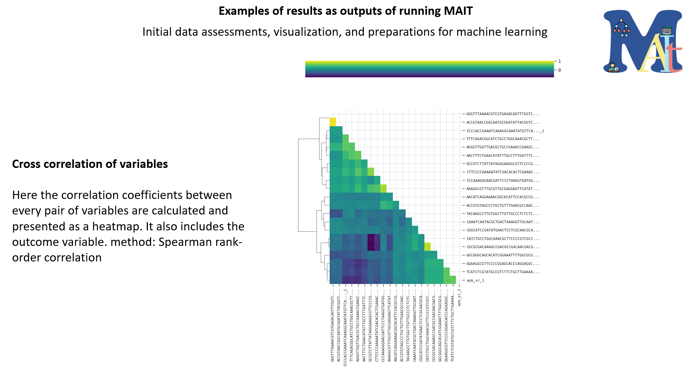

# MAIT — Medical Artificial Intelligence Toolbox

<p align="center"></p>

[](https://pypi.org/project/mait-pipeline/)
[](https://pypistats.org/packages/mait-pipeline)
[](https://scholar.google.com/scholar?cites=8130668980657492766&hl=en)
[](LICENSE)


MAIT is a Python workflow for explainable machine learning on tabular research data. The original pipeline supports binary classification, survival modelling, and regression. The current alpha package provides a ready-to-run classification demo with Logistic Regression and Random Forest.

## Run your first analysis

### 1. Create a separate Python environment

With Python 3.11 installed, open a terminal and run:

```bash
python3.11 -m venv .venv-mait
```

Activate it on macOS or Linux:

```bash
source .venv-mait/bin/activate
```

On Windows PowerShell, use `.venv-mait\Scripts\Activate.ps1` instead. This activation command is provided for convenience; the complete Windows workflow has not yet been tested.

### 2. Install MAIT and its analysis dependencies

```bash
python -m pip install "mait-pipeline[analysis]==0.1.0a4"
```

The analysis extra is needed to run the pipeline. Installing `mait-pipeline` alone installs the export tools.

### 3. Run the bundled demo

```bash
mait demo ./my-mait-demo
```

Choose a folder that does not already exist. MAIT copies the example dataset and configured script there, runs the analysis locally, and saves outputs in `my-mait-demo/results/`.

### 4. Inspect the results

A successful validated demo produced 35 files, including:

- `pipeline_report.txt`: runtime and environment information.
- `summary_table_devset.xlsx` and `summary_table_testset.xlsx`: evaluation summaries.
- `selected_model.pkl`: the saved selected model.
- `.tif` figures: model evaluation and feature explanations.

The small bundled dataset demonstrates software operation. Its performance results do not establish clinical usefulness. See the [manual](MANUAL.md) to interpret the outputs.

## Use your own data

**Check and document your dataset first:** [DAIMS—Datasheets for AI and Medical Datasets](https://github.com/PERSIMUNE/DAIMS) provides a checklist, automated data checks, and templates for dataset documentation and data dictionaries. It can help identify preparation issues before analysis with MAIT. DAIMS is optional; passing its checks does not establish that a dataset or study design is suitable for a particular analysis.

The packaged command currently runs the bundled demo. For your own dataset, use the [Streamlit configuration interface](https://maitconfig.streamlit.app/) and [configuration walkthrough](QUICK_START_DEMO.md), or adapt the [tutorial notebooks](Tutorials/).

The browser interface prepares a script; it does not run the analysis online. You must execute the script locally with its required analysis environment. Survival, regression, other model combinations, and historical numerical equivalence are not validated by the package demo.

To export the demo without executing it:

```bash
mait export-demo ./my-mait-export
```

Python users can also call `from mait import export_demo` and `export_demo("./my-mait-export")`. This is an export API, not yet a modular model-fitting API.

## Help and further reading

| Need | Where to go |
| --- | --- |
| Understand methods and outputs | [Manual](MANUAL.md) |
| Configure an analysis | [Configuration walkthrough](QUICK_START_DEMO.md) |
| Inspect detailed workflow diagrams or legacy Docker/notebook setup | [Advanced usage](ADVANCED_USAGE.md) |
| Read published applications | [Research using MAIT](RESEARCH_USING_MAIT.md) |
| Read the online documentation | [Documentation site](https://persimune.github.io/MAIT/) |
| Report a problem | [GitHub issues](https://github.com/PERSIMUNE/MAIT/issues) |

If `mait` is not found, activate the environment where you installed it. If analysis dependencies are missing, check that you installed the `[analysis]` extra. If the destination already exists, choose a new folder; the demo does not overwrite it.

When reporting a failure, include the operating system, Python and MAIT versions (`python --version`, `mait --version`), command, and error message. Do not include confidential data. LightGBM is a separate optional extra and requires a native OpenMP runtime on macOS; it is not needed by the bundled demo.

## Research using MAIT

**[Cited by 3 papers on Google Scholar](https://scholar.google.com/scholar?cites=8130668980657492766&hl=en)** · As of 3 November 2026.

| Research area | Publication |
| --- | --- |
| Gut microbiome and chronic lymphocytic leukemia | [Microbiology Spectrum](https://doi.org/10.1128/spectrum.00944-25) |
| Testicular cancer relapse prediction | [Andrology](https://doi.org/10.1111/andr.70195) |
| Severe COVID-19 risk factors | [JAMIA Open](https://doi.org/10.1093/jamiaopen/ooag079) |

[Explore these applications](RESEARCH_USING_MAIT.md) · [Papers citing MAIT](https://scholar.google.com/scholar?cites=8130668980657492766&hl=en)

Used MAIT in your research? [Share your work](https://github.com/PERSIMUNE/MAIT/issues/new) to be featured here.

## Cite MAIT

Zargari Marandi R, Frahm AS, Lundgren J, Murray DD, Milojevic M. *Medical artificial intelligence toolbox (MAIT): an explainable machine learning framework for binary classification, survival modelling, and regression analyses.* 2025. [doi:10.48550/arXiv.2501.04547](https://doi.org/10.48550/arXiv.2501.04547).

Developed by Ramtin Zargari Marandi.

## License, third-party components, and intended use


MAIT's own source code is distributed under the MIT License; see [LICENSE](https://github.com/PERSIMUNE/MAIT/blob/main/LICENSE) for its terms, warranty disclaimer, and limitation of liability.

Third-party libraries, datasets, and other components retain their respective licenses and notices. MAIT's MIT License does not relicense those components or override their conditions. Some dependencies impose additional requirements or restrictions, including restrictions on commercial use or redistribution. See [THIRD_PARTY_NOTICES.md](https://github.com/PERSIMUNE/MAIT/blob/main/THIRD_PARTY_NOTICES.md) and the applicable component's license. This notice does not establish that every combination or use is license-compatible.

MAIT is intended for research and methodological exploration. It has not been validated for clinical decision-making, diagnosis, or treatment. Example results and successful software execution do not establish clinical safety, effectiveness, or suitability for a particular purpose.

Users should independently assess data quality, study design, model assumptions, validation, and applicable legal and ethical requirements before relying on results. No commitment to ongoing maintenance or support is made unless separately agreed in writing.


## Example results


