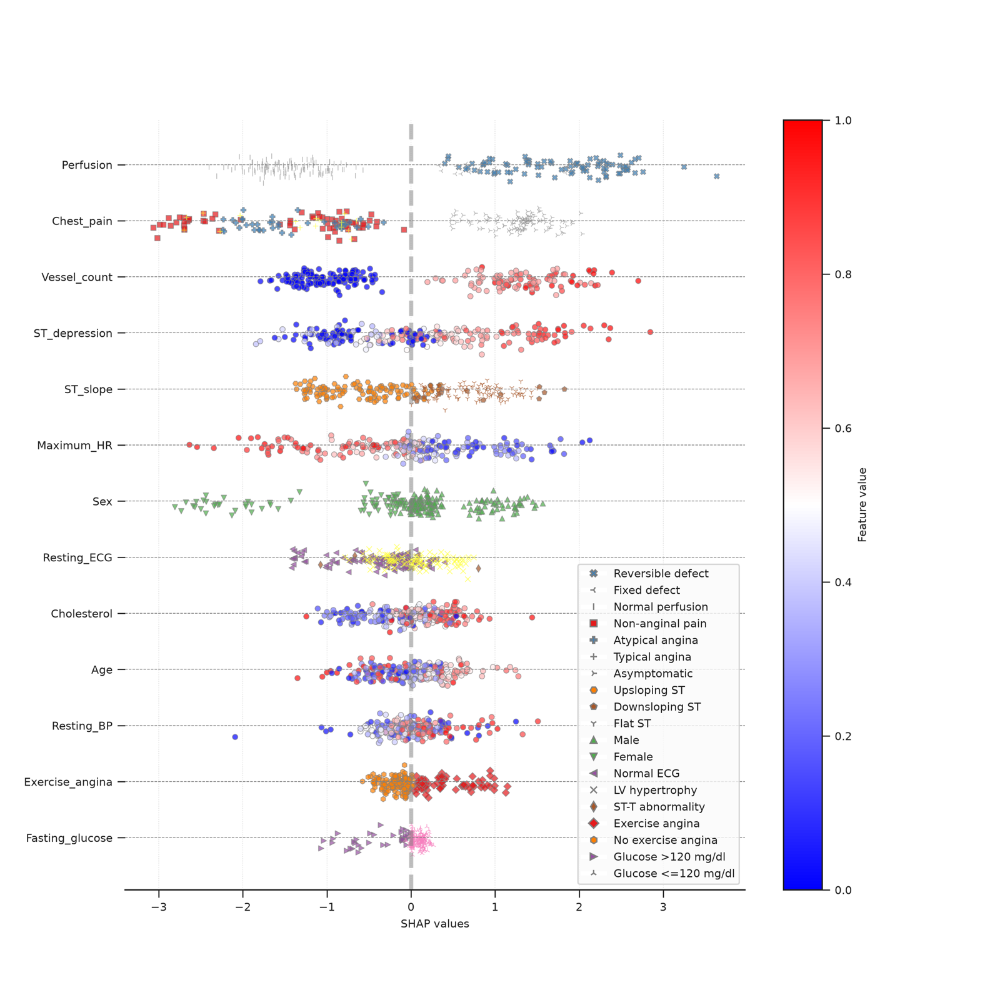

# Explainable classification with mixed clinical data in Python

This MAIT example classifies recorded heart disease status using continuous measurements and categorical clinical findings. It demonstrates how to compare models, evaluate a held-out test set, and read a SHAP plot that keeps the original categories visible.

[Open the short Kaggle demonstration](https://www.kaggle.com/code/remyz5/mait-explainable-ai-with-mixed-clinical-data) · [Open the full editable notebook](https://www.kaggle.com/code/remyz5/mait-full-notebook-mixed-clinical-data)

## Input data

The example uses the Cleveland subset of the UCI Heart Disease dataset. Each row is one observation. The notebook keeps 297 of the 303 records after excluding six with missing values. It groups recorded outcome values 1–4 as **present** and uses 0 for **absent**. Age, cholesterol, and resting blood pressure are numeric predictors. Chest-pain type, resting ECG, and exercise-induced angina are examples of categorical predictors. [UCI Heart Disease dataset and variable definitions](https://doi.org/10.24432/C52P4X)

## Run and inspect the workflow

1. Open either notebook on Kaggle. To rerun it, use a CPU session with internet access for the dependencies and dataset.
2. Follow the preparation cells and review the target and categorical predictor settings.
3. Compare CatBoost and logistic regression using three-fold cross-validation on the development set. The notebook reserves 20% of the complete records for held-out evaluation.
4. Inspect the model comparison, the held-out performance plots, and the mixed-feature SHAP figure.

## Read the result

The figure shows CatBoost explanations for the development cross-validation observations from a local run of the full notebook. Each point is a feature contribution for one observation. Position along the horizontal axis shows its contribution to the model output. Continuous values use a colour scale, while categories such as chest-pain type use named colours and markers. The held-out performance results appear separately in the notebook.

## Adapt the example

For your own tabular CSV, select the outcome, identify categorical predictors, and exclude identifiers and fields that would be unavailable at prediction time. Use **Run & Results** to configure and run binary classification on your computer. The local app also offers separate regression and survival workflows. [Local Streamlit setup](../LOCAL_APP.md)

For dataset checks and documentation before modelling, see [DAIMS](https://github.com/PERSIMUNE/DAIMS). For SHAP-based interpretation of models in R, see [ExplaineR](https://github.com/PERSIMUNE/explainer).

Dataset credit: Janosi, Steinbrunn, Pfisterer, and Detrano, *Heart Disease*, UCI Machine Learning Repository, CC BY 4.0. [Dataset citation](https://doi.org/10.24432/C52P4X)

MAIT was developed by **Ramtin Zargari Marandi, PhD**. [MAIT paper](https://doi.org/10.48550/arXiv.2501.04547) · [Software citation](../CITATION.cff)
